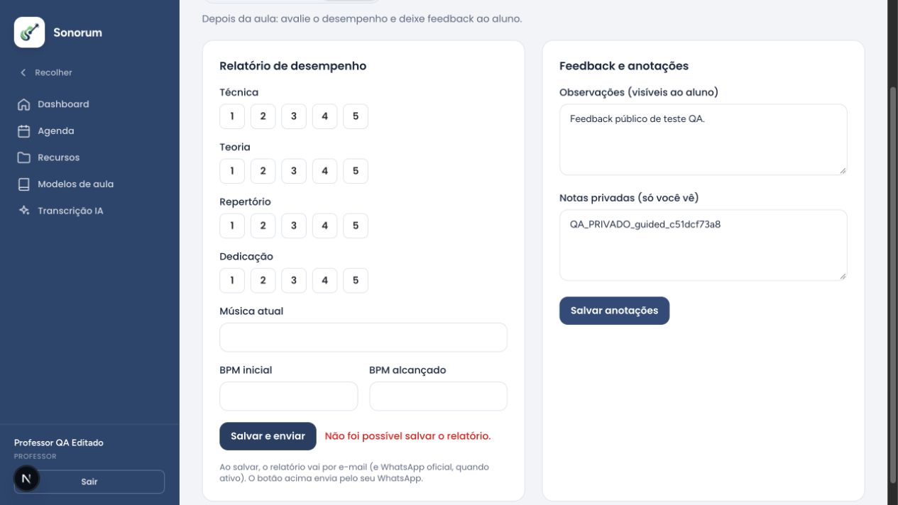

# Teste guiado técnico — 06/11/2026

Fonte de acompanhamento: quadro Sonorum society no Pump, subtarefas #30–#36. Este arquivo é evidência técnica da rodada; decisões e andamento ficam no quadro.

## Ambiente e limites

- Aplicação local em http://localhost:3100, checkout sobre `f33cf63` com alterações locais já existentes. Não representa a versão publicada.
- Navegador desktop IAB; banco e autenticação do projeto Supabase Sonorum `lfmxeklzjwhlyraxicgq`.
- Seis usuários fictícios em duas escolas identificadas por `guided-c51dcf73a8`. Conta do Matheus não utilizada e testes anteriores dele não foram considerados aprovados sem evidência específica.
- Cadastro inicial pela interface. Professor, aluno e controles provisionados como dados de teste, com notificações por e-mail desativadas, sem telefone nem calendário conectado. Escolas QA ajustadas manualmente para professional para percorrer equipe e financeiro; isso não valida compra nem mudança de plano.
- Nenhum pagamento real, alteração de código funcional, migration ou deploy nesta rodada. Provedores externos não foram validados. Não executados os scripts gerais de smoke.
- Não foi feita validação móvel, pedagógica ou de uso durante uma aula real. Matheus continua responsável por essa avaliação.

## Resultados por subtarefa

| Caso | Operações verificadas | Falhas e limites |
|---|---|---|
| #30 Cadastro, login e permissões | Validação do cadastro, cadastro válido, claims reais `user_role`/`school_id` em sessões novas de admin/professor/aluno, logout, senha incorreta, entrada professor/aluno; professor e aluno redirecionados ao próprio painel ao tentar `/admin`, aluno impedido de abrir planner, admin impedido de abrir Super Admin; aluno não lê perfil de colega; alteração direta de papel/plano rejeitada com 42501 | Falhas críticas #42 e #45. Recuperação e entrega/expiração do link de senha não executadas. Não aprovar isolamento global a partir das consultas parciais desta rodada. |
| #31 Configuração da escola | Nome de exibição e sala criados pela UI, reabertos e conferidos no banco | Recorte executado passou; personalização premium e todas as demais configurações não percorridas. Falta complementar uso real. |
| #32 Professores e alunos | Edição de nome/instrumentos de professor e nome/instrumento/anotações do aluno pela UI, persistência conferida; login dos perfis | #42 expõe professor de outra escola. Criação com entrega de credenciais e importações não executadas; preparação de fixtures não equivale a testar esses fluxos. |
| #33 Agenda | Aula avulsa 07/11, 10–11h BRT salva como 13–14h UTC; conflito de sala rejeitado sem duplicata; série semanal com cinco ocorrências entre 08/11 e 06/12; mudança de uma ocorrência para 11–12h e cancelamento apenas dela, preservando as outras quatro | #43 apaga formulário após conflito; #47 diverge no portal. Propagação de edição/cancelamento de série não executada. Preset semanal configura quatro ocorrências extras; comentário do código cita outro total. Revisar a expectativa com o domínio, sem classificar essa contagem isoladamente como falha. |
| #34 Aula, presença e relatório | Iniciar aula, encerrar como Presente, status `completed`; salvar e reabrir feedback público e notas privadas | Planejamento e relatório bloqueados por #44. Objetivos são persistidos antes da falha do plano, criando estado parcial. Nota privada exposta pela API (#45). |
| #35 Portal do aluno | Login, agenda, detalhe próprio com status Realizada, objetivos e feedback público, mensalidade; aula existente de colega retorna 404 na UI e zero registros na API; planner e área admin redirecionam | #45 permite ler nota privada diretamente. #47 mostra aula concluída como Agendada e como próxima. Relatório bloqueado por #44; materiais, metas e progresso não percorridos nesta rodada. |
| #36 Financeiro | Plano de mensalidade R$ 240 criado pela UI; matrícula ativa com vencimento dia 10; cobrança pendente de R$ 240 para 10/11/2026; valor, vencimento e status conferidos no banco e portal do aluno | #46 mostra outubro no cabeçalho quando seletor e cobrança são de novembro. Baixa, cobrança por aula, desconto, geração mensal em lote, cancelamento de matrícula e gateway não testados. Nenhuma transação executada. |

Nas consultas RLS entre escolas, usuários, professores e escolas tinham registros de controle existentes. Algumas outras tabelas da escola de controle estavam vazias; retorno vazio nesses casos não prova isolamento de dados existentes. A leitura de aula de colega foi testada com uma aula de controle efetivamente criada.

## Demandas abertas no Pump

| Card | Prioridade | Evidência e resultado esperado no reteste |
|---|---|---|
| #42 | Crítica | Admin da escola A abriu a edição do professor QA da escola B e leu nome, e-mail e instrumentos. Página usa cliente administrativo sem filtro de escola. Reteste deve negar leitura e escrita entre escolas, preservando acesso legítimo. Escrita cruzada não foi tentada. |
| #43 | Normal | Cadastro inválido e conflito na criação de aula limpam preenchimento. Preservar campos não sensíveis e tratar senha deliberadamente. |
| #44 | Alta | `upsert` de `lesson_plans` e `lesson_reports` com `onConflict: lesson_id` retorna 42P10: não existe restrição única compatível. UI falha no planejamento; professor com quatro notas preenchidas recebe “Não foi possível salvar o relatório.” Conferir dados duplicados antes de migration, garantir integridade do salvamento e reabrir plano/relatório no reteste. |
| #45 | Crítica | Aluno autenticado consultou `lessons(id, private_notes)` da própria aula e recebeu o marcador privado fictício com HTTP 200. Omitir a coluna na tela não protege a API. Restringir dados na camada de autorização e retestar papéis/escopos. |
| #46 | Normal | Financeiro com seletor 2026-11 e cobrança de 10/11 exibe subtítulo “outubro de 2026”. Conversão de data civil sem fuso coerente no cabeçalho. |
| #47 | Normal | Aula futura encerrada antecipadamente como Presente aparece Realizada no detalhe, mas Agendada em Próximas aulas e no destaque de próxima aula. A interface permite encerramento antecipado; definir agrupamento e renderizar estado verdadeiro. |

Todas as demandas têm Davi como responsável técnico e prazo do ciclo (18/11/2026). Não são correções já aplicadas. Nenhuma jornada com falha foi aprovada como concluída.

## Evidência visual

## Limpeza verificada

Removidos exclusivamente os seis usuários de autenticação e as duas escolas criadas nesta rodada, conferindo previamente os identificadores e o marcador QA. Verificação após exclusão: zero escolas, usuários, professores, aulas, salas, planos, matrículas, cobranças, planejamentos e relatórios vinculados aos dois IDs de escola; os seis usuários de autenticação deixaram de existir. Não houve cadastro financeiro externo nem cobrança em gateway. Logs técnicos de infraestrutura, segurança ou rate limit não foram expurgados.

## Encaminhamento

Corrigir e retestar primeiro #42/#45 (privacidade) e #44 (fluxo central de aula). Complementar os cenários explicitamente não executados e a validação de uso com Matheus. Esta rodada não aprova prontidão do piloto nem integrações externas.
