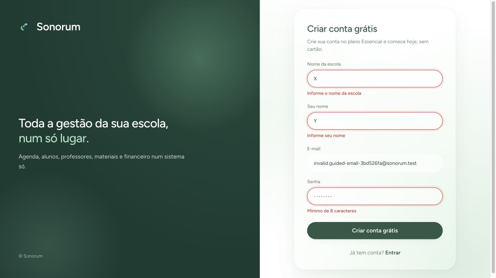
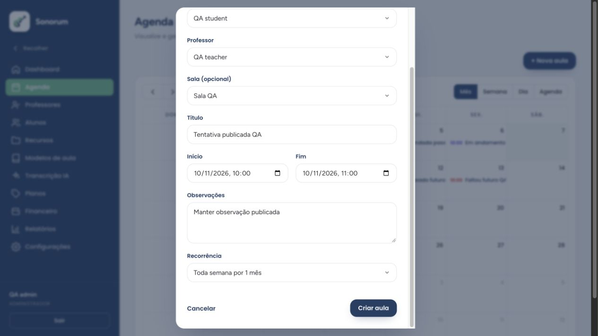
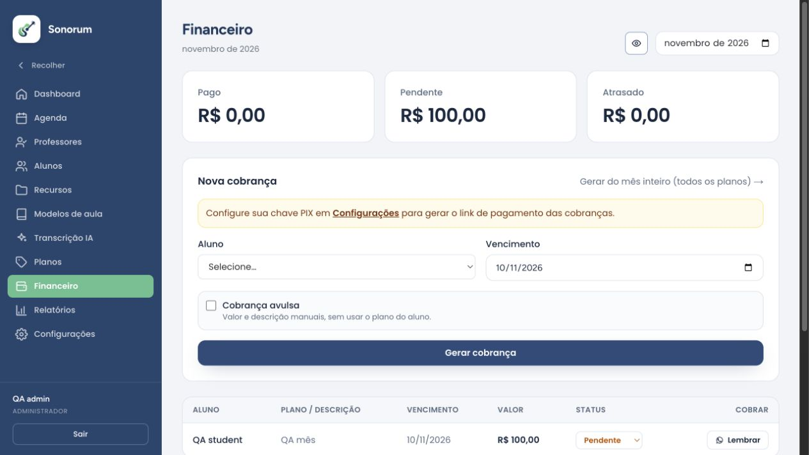
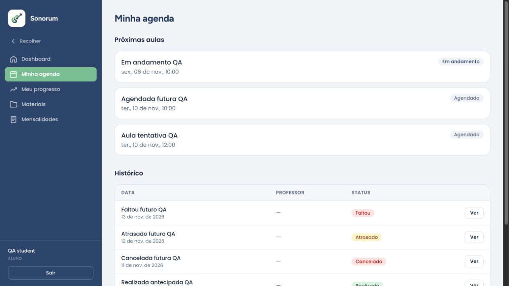

# Correções #43, #46 e #47 — 07/11/2026

Fonte de acompanhamento: Pump society Sonorum. Trabalho no checkout existente, sem descartar alterações anteriores. Aplicado padrão frontend-moderado, preservando o layout e dependências existentes.

## Mudanças

- **#43:** campos não sensíveis do cadastro ficam em estado local do componente; senha permanece fora desse estado e é limpa após resposta. Agenda mantém rascunho de aluno/professor/sala/título/observações/recorrência e impede reset nativo do formulário após ações. Nova criação redefine explicitamente o rascunho. Nenhuma senha foi adicionada ao retorno da action, storage ou relatório.
- **#46:** mês do cabeçalho financeiro usa data intermediária UTC e fuso explícito America/Sao_Paulo, evitando cair no mês anterior.
- **#47:** filtros compartilhados entre dashboard/agenda classificam aulas em andamento e agendadas futuras como próximas; estados encerrados vão ao histórico mesmo quando lançados antecipadamente. Agendada passada permanece no histórico com seu estado real. Badge usa a fonte de status existente. Em andamento fica fora do histórico, inclusive quando seu início agendado já passou.

## Testes reais

Build de produção local em 127.0.0.1:3101/3102 e app publicado conectados ao Supabase Sonorum identificado (`lfmxeklzjwhlyraxicgq`). Dados exclusivos `guided-small-3bd526fa`: três usuários, uma escola professional, professor/aluno, uma sala, oito aulas representando estados/datas e uma cobrança fictícia de R$ 100. E-mail desativado nas fixtures, sem telefones ou calendário conectado; nenhum pagamento realizado.

### Cadastro e agenda

Cadastro inválido com nomes curtos e senha curta mostrou erros, preservou nomes/e-mail e limpou senha. Nomes corrigidos e formulário reenviado sem redigitar o e-mail; apenas erro de senha permaneceu, sem criar conta. Conferido em desktop e 390×844 local, e no app publicado.

Agenda: formulário completo com aluno/professor/sala, título,10–11h, observações e recorrência semanal entrou em conflito com aula existente. Mensagem de conflito exibida; todos os campos mantidos, incluindo sala, datas e recorrência. Contagem permaneceu8, sem criação parcial. Horário corrigido para12–13h e recorrência alterada para não repetir: uma única aula criada com título, observação e sala preservados (9 no total). Novo formulário abriu limpo após sucesso. Na publicação, novo conflito foi recusado mantendo todos os campos, sem adicionar aula.

### Financeiro

Conferidos novembro/2026, dezembro/2026 e janeiro/2027, com subtítulo e seletor coerentes. Novembro exibiu somente a cobrança fictícia deR$100, pendente em10/11; dezembro e janeiro sem cobranças. Valor/vencimento/status conferidos preservados no banco. Mesmos meses conferidos na publicação, incluindo virada de ano. Não foram exercidas baixa, pagamento ou lembretes.

### Portal do aluno

Matriz com agendada futura/passada, em andamento com início passado, realizada antecipada/passada, cancelada, atrasada e falta lançadas em datas futuras. Consulta pela API e UI local/publicada confirmaram: em andamento e agendadas futuras nas próximas aulas; realizada antecipada e demais estados encerrados no histórico; detalhe antecipado comRealizada. Dashboard exibe o rótulo realEm andamento, sem promover a realizada antecipada como próxima. O novo agendamento das12h também aparece comoAgendada. Sem duplicação de linhas entre grupos nos casos verificados.

## Validação e publicação

ESLint dos arquivos alterados, TypeScript, build local e 17 regressões anteriores (#42/#44/#45) passaram. Comportamento novo foi verificado por navegador e consultas com fixtures existentes, sem testes que apenas reproduzam a implementação.

Deployment final Vercel `dpl_DK9ZzKMPh4shwucMjixJwArFKpbF`, Ready, URL técnica `https://sonorum-8n4s71fuq-pump-sites.vercel.app`, associado a `https://app.sonorum.com.br`. Build remoto aprovado, cadastro e landing responderam200. Não houve migration nesta rodada.

## Achados independentes

- **#48:** sessão local antiga de conta QA removida provocou ciclo auth/painel atéERR_TOO_MANY_REDIRECTS e logs comgetCurrentUser=null. Registrado para investigação/reteste; não alterado neste trabalho. Para testar estes ajustes, foi usada origem local sem esse cookie. Recursos de desenvolvimento bloquearam a origem127; a validação funcional foi feita no build de produção local, sem reduzir proteções do servidor de desenvolvimento.
- **#49:** em390×844, menu expandido comprime o portal, prejudicando leitura. Evidência salva; problema de layout preexistente, independente do status#47, pendente de correção e confirmação publicada. A verificação móvel do cadastro passou; o portal móvel não foi aprovado como experiência completa.

## Limpeza

Três usuários Auth e escola QA removidos, com nove aulas, sala, vínculo de professor e cobrança fictícia por cascata. Identidades conferidas antes de remover; ausência das contas Auth e zero registros nas tabelas correspondentes verificados. Credencial temporária removida do registro local. Dados reais/conta do Matheus não utilizados. Logs de infraestrutura não expurgados.

#43/#46/#47 concluídos no escopo descrito. Jornadas amplas e uso pedagógico não recebem aprovação integral por este resultado; #48/#49 permanecem no backlog.

## Evidências

