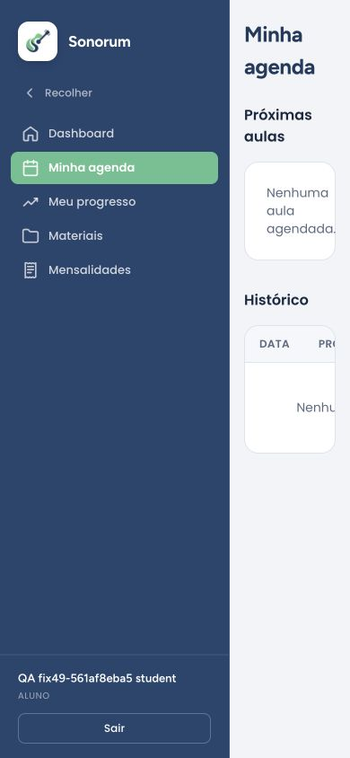
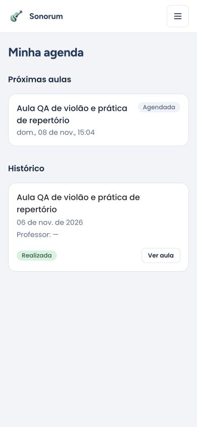
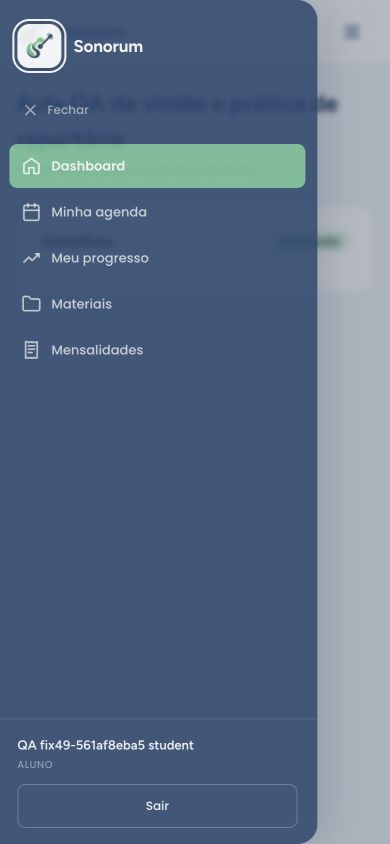
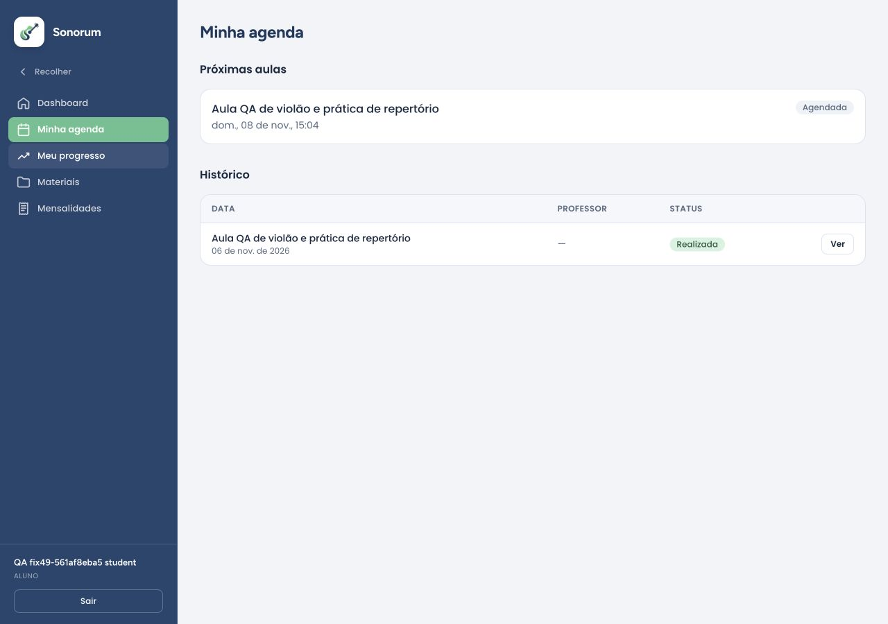

# Menu e agenda do portal no celular — #49

Corrigido e retestado em 07/11/2026, no build local e em https://app.sonorum.com.br.

## Problema reproduzido

Em `/student/schedule`, viewport 390×844, a sidebar expandida ocupava 256 px e deixava apenas 134 px para o conteúdo. O histórico preenchido também cortava o botão de abrir a aula mesmo depois de liberar a largura da página.

## Correção

Até 768 px, o shell usa barra compacta com marca e botão de menu. A navegação abre em um `dialog` modal sobre o conteúdo, sem reservar coluna lateral. A preferência persistida de recolhimento continua sendo usada no desktop e não reduz os textos do menu móvel. O histórico do aluno usa cards no celular e tabela no desktop.

O menu tem nome acessível e estado de expansão, foco contido pelo diálogo nativo, retorno do foco ao botão, fechamento por Escape, botão, clique no fundo e escolha de link. A página ao fundo fica bloqueada para interação/rolagem enquanto o diálogo está aberto. Ao mudar para desktop, o diálogo fecha. A animação de entrada respeita movimento reduzido. Nenhuma regra de acesso foi alterada.

## Validação

- ESLint dos componentes/página alterados, build de produção com TypeScript e `git diff --check` passaram.
- Build local em 390×844 e 320×740: conteúdo ocupa a largura disponível; cards e link de abrir aula sem corte. Em 320 px, documento e main mediram 320 px e o botão ficou dentro da área visível.
- Desktop local 1280×900: sidebar e tabela preservadas; recolher/expandir e recarregar mantêm a preferência. Voltar ao celular com preferência recolhida conserva o menu completo e o conteúdo sem coluna lateral.
- Local: abertura por Enter, dez avanços de Tab com foco ainda dentro do menu, Escape com retorno ao botão, clique no fundo, navegação a Meu progresso e fechamento ao redimensionar para desktop passaram.
- Produção 390×844: documento/main mediram 390 px; reload com preferência de desktop recolhida não comprime a agenda; menu continua com rótulos completos. Fechar por botão e Escape, abrir com Enter e navegar pelos links passaram.
- Produção: link “Ver aula” abriu o detalhe da aula fictícia; retorno à agenda pelo menu passou. Desktop 1280×900 manteve tabela e preferência após reload. Preferência inicial expandida restaurada ao final.
- Saída pelo menu do aluno, login do professor e navegação do professor para `/schedule` passaram. O calendário do professor manteve a largura disponível (375 px de área útil em viewport de 390 px com scrollbar) e o menu fechou ao navegar.

Deploy READY: `dpl_4AqDx3f7psqwMcVzKnnkPqnA7TLG`, `sonorum-jhegojytt-pump-sites.vercel.app`. Alias aplicado a `app.sonorum.com.br`.

## Dados e limites

Dados de teste no Supabase Sonorum identificado (`lfmxeklzjwhlyraxicgq`): uma escola, um professor, um aluno e duas aulas fictícias para a rodada principal. Houve ainda uma conta/escola temporárias de preparação, removidas antes da rodada principal. As contas Auth, escolas e aulas criadas foram removidas e a ausência verificada por ID. Nenhum usuário real foi alterado. Credenciais temporárias retiradas dos arquivos auxiliares. Servidor local de teste encerrado e viewport restaurado.

Teste em navegador com viewport de celular; não executado em aparelho físico nem com leitor de tela. Este reteste aprova o defeito #49, não toda a jornada do portal #35 nem todos os fluxos do calendário do professor.

## Evidências

