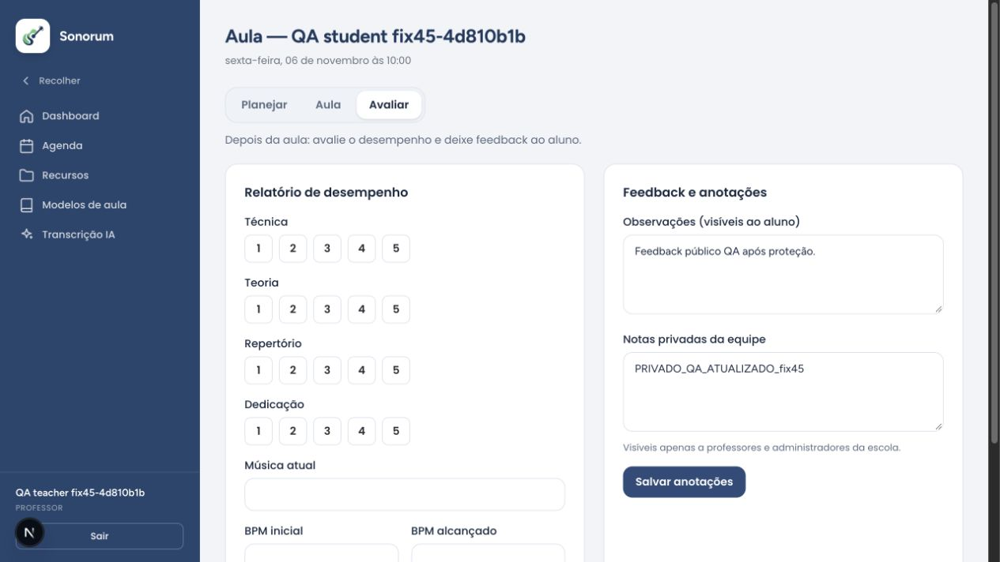
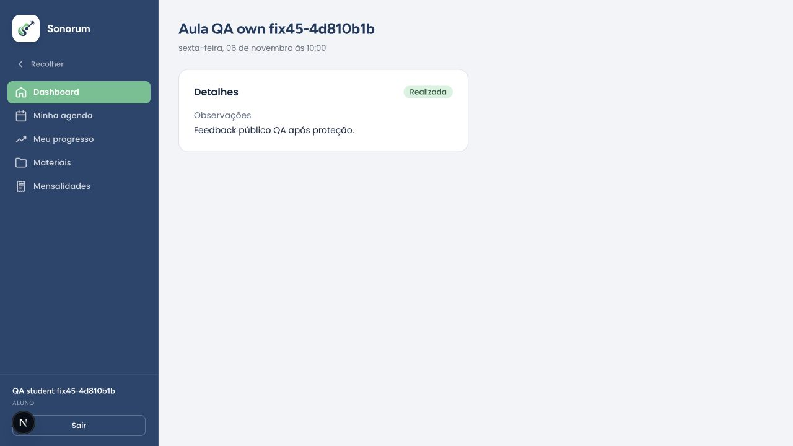
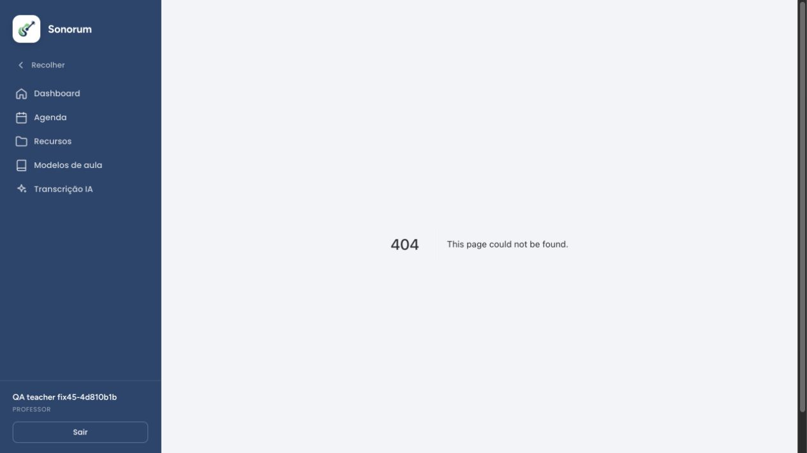
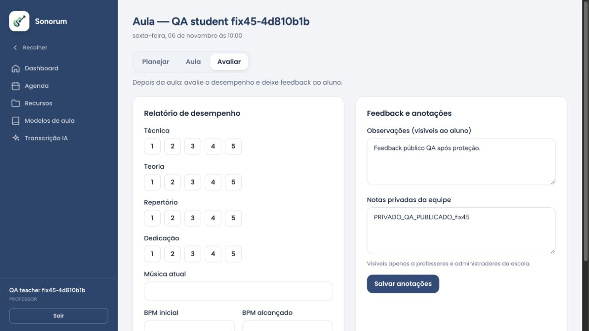
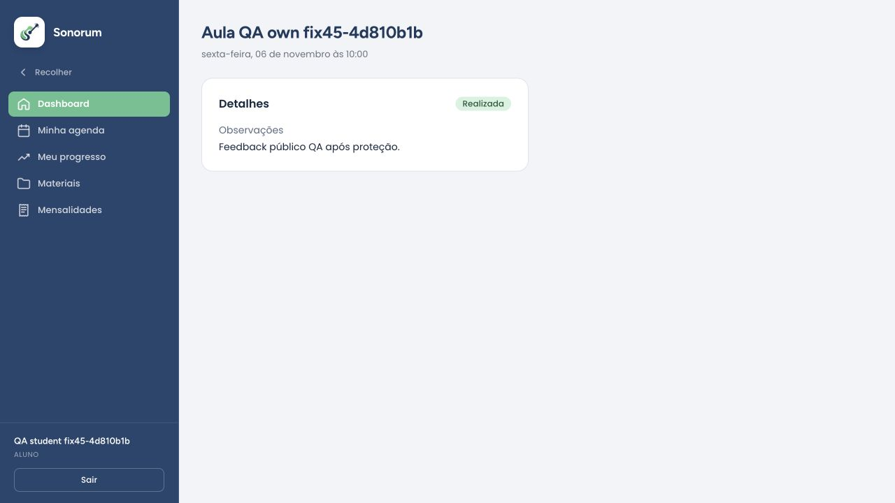

# Correção preparada — #45, notas privadas da aula

Data: 07/11/2026. Fonte de acompanhamento: Pump society Sonorum, bug #45, jornadas #30/#34/#35.

## Mudança

A projeção de aulas acessível a usuários autenticados passa a excluir `private_notes` por privilégio de coluna do PostgreSQL. Consultas explícitas, `SELECT *`, conversão da linha inteira em JSON e filtros sobre a coluna privada são recusados. RLS continua limitando quais aulas cada pessoa pode ler. Observações públicas (`notes`) permanecem acessíveis ao aluno da aula.

O planner consulta as notas por `get_lesson_private_notes(uuid)`, função com autorização no banco: professores e administradores da mesma escola; Super Admin mantém o acesso administrativo já previsto nas políticas existentes. Outra escola não recebe conteúdo; aluno e anônimo são recusados. Não foi introduzida uma regra nova de exclusividade por autor. O rótulo passou de “só você vê” para “Notas privadas da equipe” para refletir a autorização da escola já existente.

Nenhuma nota histórica é movida, apagada ou regravada pela migration. INSERT/UPDATE/DELETE e acesso backend por service_role são preservados. A action de anotações também valida papel de professor/admin antes de consultar o banco. Falha na função privada interrompe o carregamento do planner; não há fallback que use credencial administrativa para contornar a proteção.

## Publicação em duas fases

1. Aplicar `0036_private_lesson_notes.sql`: instala a função de leitura protegida, de forma compatível com o planner antigo. **Esta fase isolada ainda não fecha a exposição da coluna.**
2. Publicar a aplicação atualizada, que usa essa função; verificar leitura e salvamento legítimos de professor/admin.
3. Aplicar `0037_private_lesson_notes_grants.sql`: remove SELECT amplo e permite apenas colunas compartilháveis. Esta migration exige a função da fase anterior.
4. Executar `verificar-notas-privadas.sql` e retestar a API com aluno próprio, colega, professor/admin da mesma escola, outra escola e anônimo. Verificar telas de aluno, planner e relatório compartilhado.

Não inverter a ordem: o planner antigo consulta diretamente a coluna privada e deixaria de carregar após a fase 2 do banco. Uma reversão de aplicação depois da ativação deve manter a leitura pela função; não restaurar SELECT amplo para contornar um erro.

## Verificação realizada

`node --test scripts/private-lesson-notes.test.mjs` executa quatro testes: três de aplicação (página/action reais com dependências isoladas) e uma matriz de autorização em **PostgreSQL real temporário**, sem acessar `.env.local` ou dados hospedados.

O banco isolado usa os helpers e políticas de aulas de `0002_rls.sql`, dados fictícios de duas escolas, admin, professor, aluno, colega, administrador da outra escola, Super Admin e service_role. Foram conferidos:

- aluno lê somente feedback próprio; não lê colega nem nota privada;
- leitura direta, `*`, linha como JSON e filtro pela coluna privada recusados;
- função privada recusa aluno/colega/anônimo;
- professor/admin da mesma escola leem via função e mantêm salvamento;
- administrador de outra escola não recebe a nota;
- acesso administrativo de Super Admin e backend preservado;
- notas históricas preservadas, feedback público atualizado visível ao aluno;
- aluno não consegue alterar nota privada;
- migration de ativação sem preparação falha; preparação mantém compatibilidade antiga; reaplicação não reabre permissões;
- planner recusa aluno antes de consultar conteúdo e falha fechado se RPC indisponível;
- action recusa aluno antes de acessar banco.

Também foram aprovados ESLint, TypeScript e build. Testes de regressão #42 foram executados novamente. O cluster temporário e os dados fictícios são removidos pelo teste; nenhuma conta ou escola foi criada no Supabase nesta rodada.

## Estado externo antes da aplicação dos SQLs

**As migrations não foram aplicadas ao Supabase hospedado e a aplicação não foi publicada.** Uma consulta de diagnóstico à função, com UUID aleatório sem ler dados reais, retornou `PGRST202`/404 no projeto Sonorum `lfmxeklzjwhlyraxicgq`: função ainda indisponível. Isso não é evidência de proteção ativa. A exposição previamente confirmada deve ser considerada pendente até ativação e reteste externo.

Não foi feita validação da API hospedada depois da correção nem percurso visual do novo planner com a migration aplicada. O teste SQL isolado comprova os privilégios da migration no cenário descrito, não a configuração do Supabase de produção. #45 permanece em andamento no Pump; #30/#34/#35 seguem sem aprovação integral. #44, salvamento de planejamento/relatório, continua independente desta correção.

## Reteste após o usuário aplicar os SQLs

Ainda em 07/11/2026, o usuário informou que aplicou os SQLs. Foram realizadas 19 verificações pela API real do projeto Supabase Sonorum com sessões novas e dados exclusivos `fix45-4d810b1b`: seis contas e duas escolas QA, três aulas com conteúdo público e privado fictício existente. As 19 passaram:

- coluna privada recusada com HTTP403/42501 para aluno, colega, professor, admin e admin de outra escola;
- aluno não lê coluna privada nem com `*` ou filtro por seu conteúdo;
- função privada recusa aluno, colega e anônimo;
- função lê o marcador existente para professor/admin da mesma escola e retorna null para a outra escola;
- projeção pública lê a aula própria e mantém isolamento de colega/outra escola;
- credencial backend mantém acesso; marcador da fixture preservado após as tentativas.

O planner local conectado ao banco hospedado abriu a nota privada para o professor, salvou alterações pública/privada e reabriu com os valores persistidos (20ª verificação). O portal local do aluno exibiu apenas feedback público. Isso comprova funcionamento com as migrations efetivamente ativas, além dos testes SQL anteriores.

Foi testado também `https://app.sonorum.com.br`: login do professor funcionou, mas o planner publicado retornou404 para a mesma aula que abriu localmente. Essa incompatibilidade exigiu publicação do app compatível. O usuário autorizou explicitamente “Publicar agora”.

Evidências:

## Publicação e confirmação final

Publicação autorizada pelo usuário e concluída no projeto Vercel `pump-sites/sonorum`, deployment `dpl_2Yof2UHKa6KDQEZPzSA5f73kX2eS` (Ready), URL técnica `https://sonorum-cydx9nxs0-pump-sites.vercel.app`. Build remoto passou. O domínio `https://app.sonorum.com.br` foi associado explicitamente a esta versão. Login do app e landing em `https://www.sonorum.com.br` responderam HTTP200.

No domínio publicado, professor QA entrou, abriu o planner da mesma aula que antes retornava404, alterou a nota privada, salvou e reabriu. Persistência conferida no banco. Aluno QA entrou e viu somente feedback público no detalhe; coluna privada e função continuaram recusadas com42501 na API após o salvamento publicado.

O mesmo deployment contém #42. Admin QA tentou editar um professor efetivamente existente da escola B:404 sem dados. Edição do professor da própria escola abriu, salvou novo nome e persistiu; dados do controle B preservados. Escrita cruzada continua coberta pelo teste automatizado isolado descrito no relatório #42, sem requisição de alteração cruzada a dados hospedados.

Limpeza final verificada: seis usuários Auth e duas escolas QA removidos, incluindo três aulas e dois vínculos de professor por cascata. Confirmados zero registros vinculados aos IDs em escolas, perfis, professores, aulas, planos de aula, relatórios, cobranças e matrículas; contas Auth ausentes. Credencial temporária removida do registro local. Logs técnicos não expurgados. Conta do Matheus e dados reais não utilizados.

#45 e #42 publicados e retestados no escopo descrito. Isso não aprova integralmente #30/#34/#35, demais jornadas, integrações ou prontidão do piloto. #44 permanece pendente.
