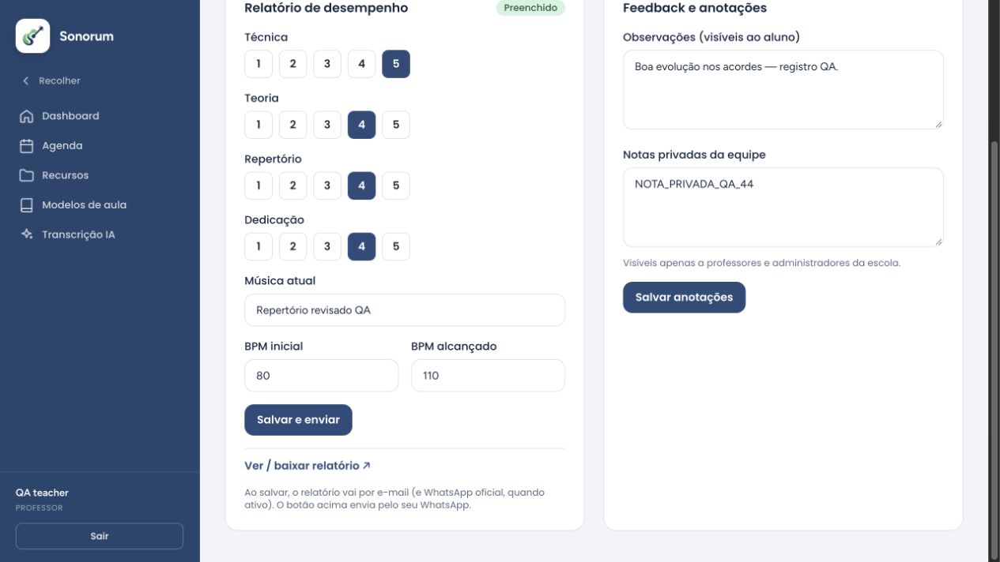
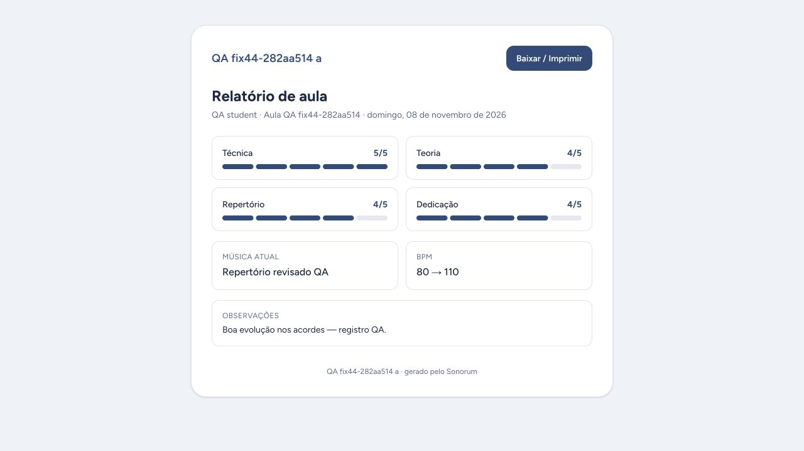
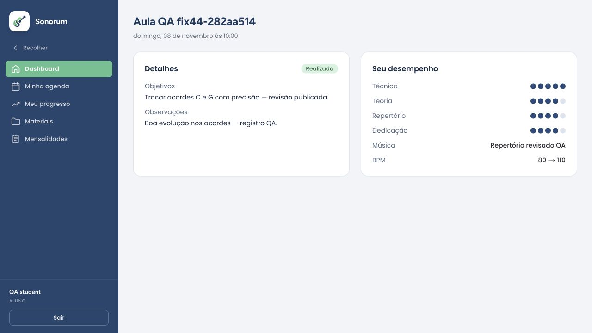

# Correção #44 — planejamento e relatório

Data: 07/11/2026. Acompanhamento: bug #44, jornadas #34/#35 no Pump society Sonorum.

## Implementação local

Migration `0038_atomic_lesson_planning.sql`:

- verifica duplicidades por aula e vínculos de escola inconsistentes antes de alterar o esquema; se encontrar, aborta a transação sem apagar ou escolher registros;
- adiciona unicidade de `lesson_id` a `lesson_plans` e `lesson_reports`, corrigindo o contrato de `upsert` que retornava42P10;
- instala `save_lesson_plan(uuid,text,jsonb)` com SECURITY INVOKER, RLS, papel de staff, escola derivada da aula e bloqueio da linha para serializar salvamentos concorrentes;
- objetivos e planejamento são gravados numa transação: qualquer falha reverte ambos;
- mantém notas gerais existentes quando aplicar modelo não envia esse campo; limpar `specific_data` ao aplicar modelo preserva o comportamento anterior.

`saveLessonPlan` e `applyTemplateToLesson` usam a transação. Não há atualização separada de objetivos antes/depois do plano. Relatório continua usando seu upsert único, que passa a ter a restrição exigida no banco. Notificação não é tentada se o relatório falhar ao salvar.

## Verificação realizada

Auditoria somente de metadados no Supabase Sonorum `lfmxeklzjwhlyraxicgq`: nenhuma linha em `lesson_plans` ou `lesson_reports` no momento da consulta; zero duplicidades e zero divergências de escola. Não foram lidos textos de aulas reais. A migration repete as verificações sob bloqueio, protegendo contra mudanças depois da auditoria.

Testes em PostgreSQL real temporário usam DDL, helpers e políticas do projeto, inclusive as restrições de notas privadas de0036/0037. Cobrem abortar sem perda em duplicidade de planos/relatórios, inconsistência de escola, preservação de histórico, reaplicação, criar/editar sem duplicar, aplicação de modelo, falha forçada após gravar objetivos com rollback completo, aluno/outra escola/anônimo negados, salvamentos concorrentes coerentes e leitura do relatório pelo aluno. Testes das actions confirmam uma chamada transacional, envelope dinâmico preservado, falha sem falso sucesso e relatório não salvo sem notificação.

Comandos de verificação:

```sh
node --test scripts/lesson-planning.test.mjs scripts/private-lesson-notes.test.mjs scripts/teacher-edit-isolation.test.mjs
npx eslint lib/actions/lessons.ts lib/actions/lesson-templates.ts lib/types/database.ts scripts/lesson-planning.test.mjs
npx tsc --noEmit
npm run build
git diff --check
```

## Ativação e reteste pendentes

Aplicar0038 antes da publicação do app atualizado: ela é compatível com os upserts da versão publicada e não revoga acesso existente. Depois, publicar o app com a transação e retestar criar/editar/reabrir planejamento e relatório na UI, comparar com banco e portal, e confirmar isolamentos usando dados fictícios. Plano/relatório salvos não comprovam entrega por e-mail/WhatsApp; essas integrações são validadas separadamente.

Checks de catálogo sem conteúdo sensível em `verificar-planejamento.sql`. Esta evidência local não significa migration aplicada, publicação ou aprovação integral das jornadas. Nenhuma mudança foi feita no Supabase para implementar esta correção até este registro; #44 permanece em andamento e #34 bloqueado até ativação e reteste.

## Atualização: SQL aplicado, publicado e retestado

O usuário confirmou aplicação de0038. Reteste em07/11 com dados exclusivos `fix44-282aa514`, cinco contas fictícias, duas escolas, duas aulas, um planejamento e um relatório:

- professor e administrador salvaram pela função com sessões próprias; aluno e administrador da outra escola recusados com42501;
- interface local criou e editou plano completo (objetivos, aquecimento, técnica, repertório, tarefa, BPM e notas); reabertura e banco conferidos, sempre um plano;
- fase Aula recuperou o conteúdo, iniciou a aula e registrou Presente/`completed`;
- relatório criado com notas4 e80→90BPM, editado para técnica5 e80→100BPM; reabertura e banco confirmaram um registro;
- aluno leu plano e relatório próprios pela API, outra escola não leu; leitura direta da coluna privada continuou recusada;
- interface publicada editou novamente objetivos/plano e relatório (80→110BPM), mantendo uma linha de cada;
- portal publicado do aluno mostrou objetivos revisados, feedback, repertório e evolução80→110; marcador privado ausente;
- relatório compartilhável abriu com as quatro notas, repertório, BPM e feedback públicos.

Build remoto aprovado no projeto Vercel `pump-sites/sonorum`. Versão final: `dpl_FMaUoBmLU8nKuk8RnUhV4fVxPZz5`, URL técnica `https://sonorum-jvzr3f6is-pump-sites.vercel.app`, associada a `https://app.sonorum.com.br`.

O reteste identificou `NEXT_PUBLIC_APP_URL` de produção ainda apontando a `sonorum.com.br`; o link de relatório era redirecionado à landing emwww. Corrigido para `https://app.sonorum.com.br`, armazenado como configuração pública na Vercel, e republicado. Link gerado pela versão final conferido na UI e aberto comHTTP200. O alvo Preview da variável anterior foi preservado. Login do app e landing responderam200.

### Limites

Preferência de e-mail das fixtures desativada e nenhum telefone cadastrado. A confirmação visual “Salvo e enviado” **não foi tratada como prova de entrega**; e-mail/WhatsApp seguem em seus testes de integração. Aplicação de modelo e rollback forçado foram verificados nos testes de aplicação/PostgreSQL isolado; não se instalou trigger de falha nem se alteraram constraints para forçar erros no projeto hospedado. A revisão pedagógica de Matheus permanece pendente, assim como os demais cenários das jornadas amplas.

### Limpeza

Cinco usuários Auth e duas escolas QA removidos, incluindo as duas aulas, planejamento, relatório e vínculo de professor por cascata. Identidades e marcador conferidos antes de excluir; verificada ausência das contas Auth e zero escolas, perfis, professores, aulas, planos e relatórios vinculados aos IDs. Credencial temporária removida do registro local. Logs de infraestrutura não expurgados; dados reais e conta do Matheus preservados.

### Evidências







#44 concluído no escopo do salvamento; #34 sai do bloqueio técnico e segue em andamento para complemento de uso real. #35 continua em andamento pelos demais cenários/achados.
