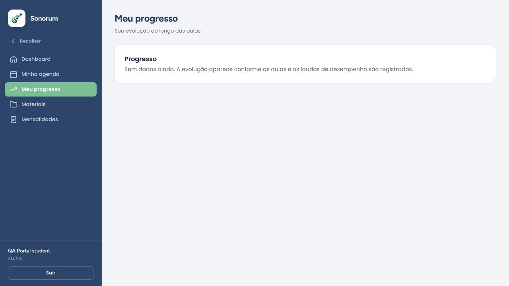
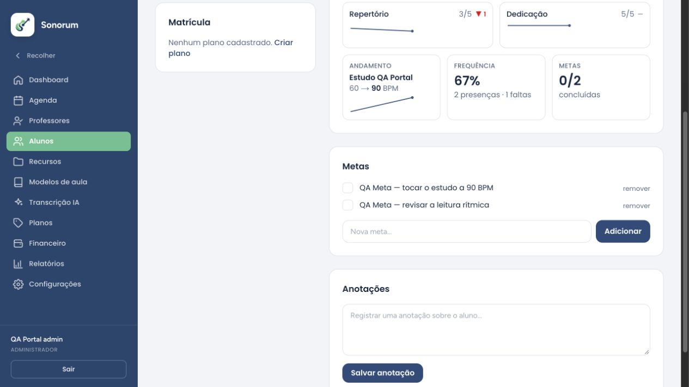
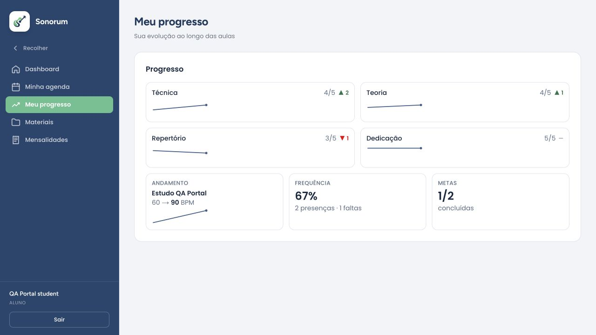
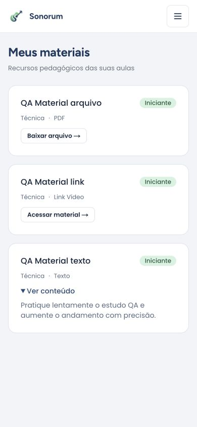
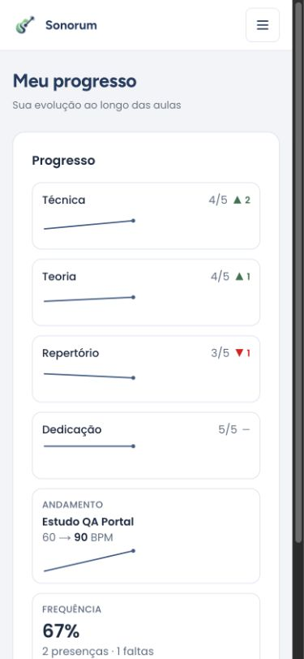

# Portal: materiais, metas e progresso — #35

Rodada técnica de 07/11/2026 em https://app.sonorum.com.br. Deploy conferido como READY: `dpl_2nJ4S17wA5DcaBq7SriJnwUSMVWu`, `sonorum-kfozaaq6y-pump-sites.vercel.app`. Não houve alteração funcional, migration ou novo deploy nesta rodada.

## Ambiente e preparação

Supabase Sonorum identificado (`lfmxeklzjwhlyraxicgq`), navegador IAB desktop e viewport390×844. Contas e dados exclusivamente fictícios: administrador que também leciona, aluno, colega da mesma escola, aluno de outra escola; duas escolas professional; sete aulas, quatro relatórios, sete recursos pedagógicos, um PDF privado e quatro metas (duas criadas pela UI, duas de controle). Notificações desativadas nas fixtures, sem telefones ou Google conectado. Não usada a conta do Matheus.

Relatórios, presenças, recursos e vínculos foram preparados como fixtures para testar leitura/agregação; essa preparação não valida seus formulários de criação. Criação de metas e suas mudanças de estado foram realizadas pela interface real.

## Casos e resultados

| Caso | Esperado e observado | Resultado |
|---|---|---|
| Aluno inicialmente sem histórico | Dashboard sem aulas/metas, Materiais com estado vazio e Progresso com mensagem sem dados | Passou |
| Criar metas | Admin adicionou duas metas diferentes pela UI; duas linhas persistidas, sem duplicação; progresso administrativo passou de0/0 para0/2 | Passou |
| Concluir e desmarcar | Aluno concluiu a meta de90BPM: completed=true no banco, dashboard1/2 e Progresso1/2. Desmarcou: completed=false; dashboard0/2 e Progresso0/2 ao navegar pelo menu móvel | Passou |
| Notas e variações | Relatórios cronológicos [2,3,4,5] e[4,4,3,5]: UI do admin/aluno mostrou Técnica4/5▲2, Teoria4/5▲1, Repertório3/5▼1, Dedicação5/5 sem variação | Passou |
| Andamento | Último relatório com música “Estudo QA Portal”, inicial60 e alcançado90: valores exibidos60→90BPM | Passou |
| Frequência | Uma aula completed, uma late e uma missed: duas presenças, uma falta,67%; canceled e scheduled ficaram fora do denominador | Passou |
| Materiais atribuídos | Portal mostrou exatamente texto, link e PDF das aulas passadas do aluno. Materiais exclusivos de aula futura, cancelada, colega e outra escola não apareceram | Passou |
| Texto e link | Expandir “Ver conteúdo” mostrou o texto completo. URL do link conferida comohttps://www.sonorum.com.br/; não foi testado conteúdo de vídeo externo | Passou no escopo descrito |
| PDF | Link assinado efetivamente renderizado pelo app retornou HTTP200, MIMEapplication/pdf e bytes idênticos ao PDF sintético. URL pública sem assinatura não retornou200 | Passou |
| Isolamento de metas/relatórios | Sessão do aluno leu somente seus dois relatórios e duas metas; SELECT/UPDATE de completed nas metas de controle retornou zero linhas, e controles permaneceram pendentes. UPDATE de texto da própria meta foi negado | Passou |
| Materiais entre escolas | Recurso de controle de outra escola retornou zero linhas pela sessão do aluno | Passou |
| Mobile | Materiais com texto expandido e progresso funcionaram em390×844. Documento, main e viewport mediram390px na página de materiais; menu não reservou coluna lateral | Passou |

## Contrato de acesso e limites

- A biblioteca de recursos da própria escola é legível por membros conforme a política atual. O filtro por aulas atribuídas/passadas é o contrato da tela “Meus materiais”; não afirmar que o aluno é impedido de consultar todo recurso não atribuído da biblioteca da sua escola pela API.
- A criação direta de URL assinada via sessão do aluno foi negada pelo Storage. O fluxo do app usa URL gerada pelo servidor após selecionar os recursos permitidos; esse link foi verificado. Não foi necessário ampliar permissões ou aplicar a migration0027 nesta rodada.
- Não foram aguardados vencimento/reutilização da URL assinada; teste confirmou acesso e conteúdo enquanto válida. Upload pelo formulário, anexação pela UI do professor, exclusão/edição de metas pelo administrador e falhas de rede não foram exercitados.
- Notas/progresso foram comparados com fixtures conhecidas; a adequação pedagógica continua com Matheus. Teste móvel feito por viewport, sem aparelho físico ou leitor de tela.
- Nenhuma nova falha confirmada neste recorte. #35 permanece em andamento pelos cenários restantes e validação de uso real; não aprovar prontidão integral do piloto a partir destes casos.

## Limpeza

Quatro contas Auth e suas linhas públicas, duas escolas, sete aulas, quatro relatórios, sete recursos, respectivos vínculos, quatro metas e vínculo de professor removidos. Ausência conferida nas tabelas e Auth por IDs. PDF privado removido do Storage e tentativa de download após remoção falhou conforme esperado. Credencial temporária retirada do arquivo auxiliar; arquivo temporário com URL assinada eliminado; viewport restaurado e aba de teste fechada. Nenhum dado real alterado.

## Evidências

