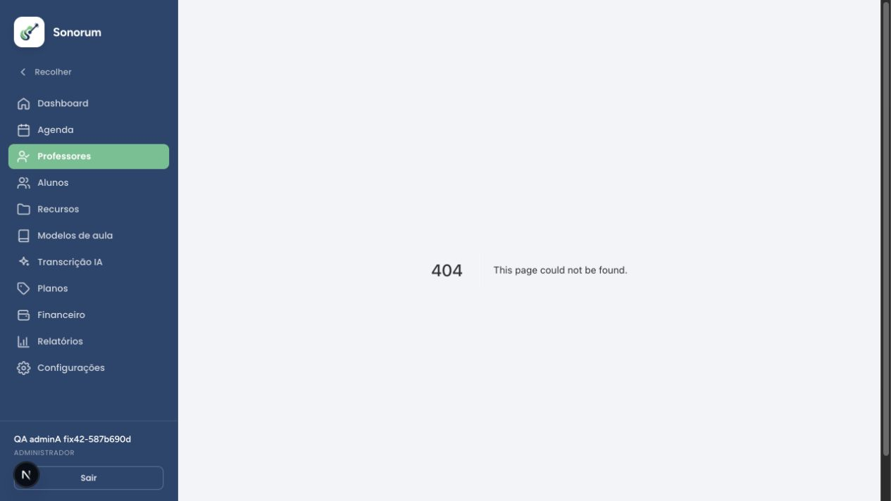
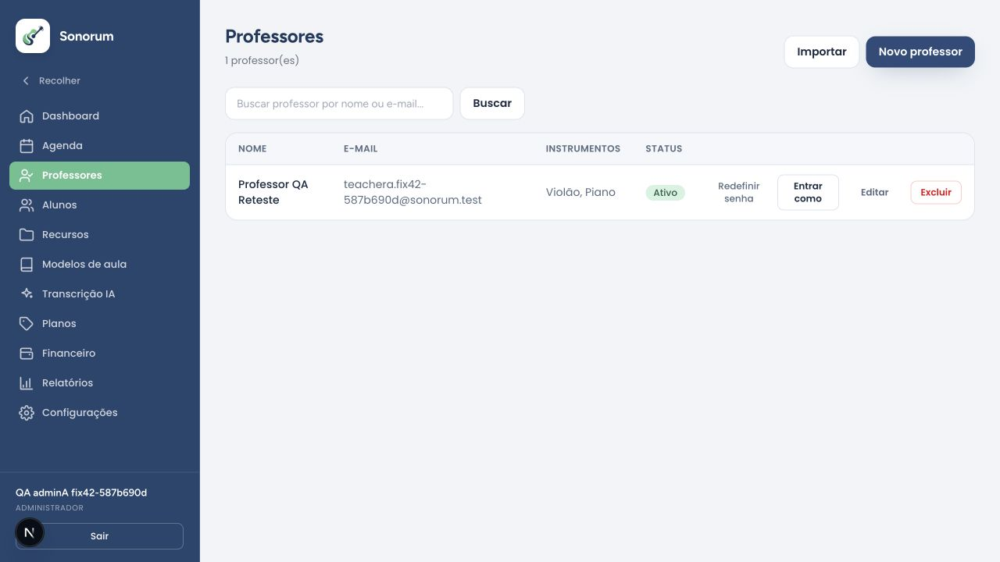
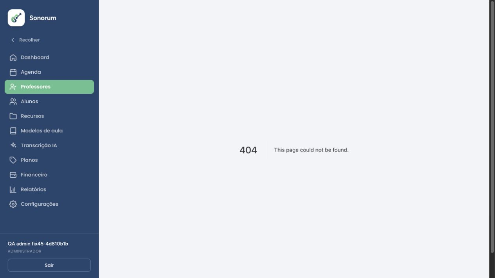
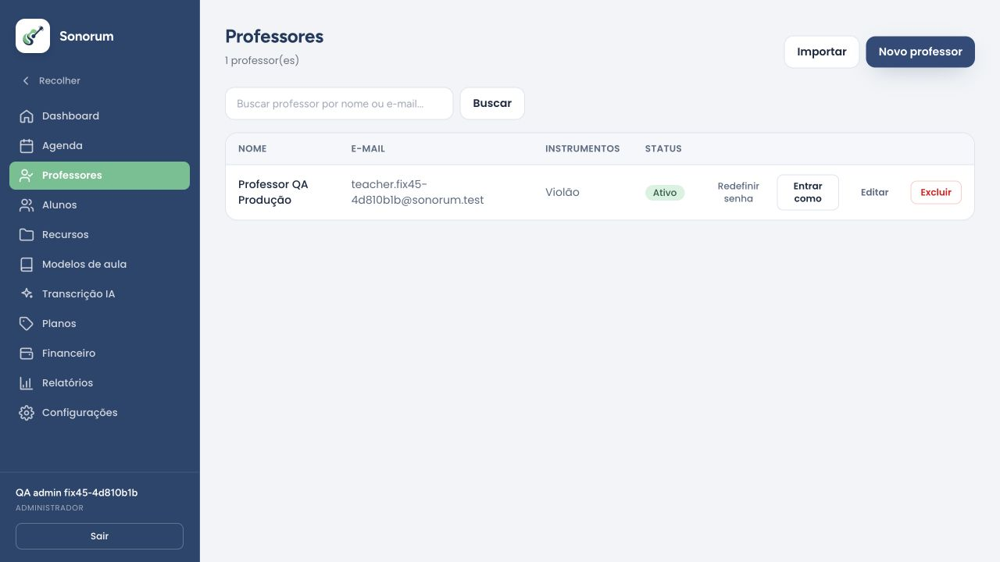

# Reteste #42 — edição de professores entre escolas

Data: 07/11/2026. Acompanhamento: Pump society Sonorum, bug #42 e jornadas #30/#32.

## Correção local

`app/(app)/admin/teachers/[id]/edit/page.tsx` agora valida administrador com escola no servidor, consulta com cliente da sessão (RLS) e filtra explicitamente `teachers.school_id`. Professor de outra escola resulta em página 404 sem carregar nome, e-mail ou instrumentos. Mantido o redirecionamento de contas Solo para `/profile`.

`lib/actions/update-user.ts` mantém a autorização de administrador e a verificação do vínculo antes de qualquer mudança no Auth. O filtro de escola também foi acrescentado à busca de professor e às atualizações dos perfis de usuário/professor.

## Verificação

Ambiente: app local http://localhost:3100, checkout com trabalho local preexistente, Supabase Sonorum `lfmxeklzjwhlyraxicgq`, navegador desktop IAB. Não representa reteste do app publicado.

Fixtures exclusivas `fix42-587b690d`: duas escolas professional, administrador/professor/aluno na escola A e professor na B. Dados preparados via API administrativa exclusivamente para o teste; sem telefones ou envio de credenciais. Nenhuma conta real foi utilizada.

| Cenário | Resultado |
|---|---|
| Admin A abre URL de edição do professor B | 404 no navegador, sem dados do professor B |
| Admin A abre professor A | Formulário com dados corretos |
| Admin A altera nome e instrumentos do professor A | Redireciona à lista; nome e instrumentos conferidos persistidos no banco |
| Professor B após edição legítima de A | Nome e instrumentos originais preservados |
| Professor A tenta URL administrativa de edição | Redirecionado a `/teacher` |
| Aluno A tenta URL administrativa de edição | Redirecionado a `/student` |

Oito testes automatizados sem rede em `scripts/teacher-edit-isolation.test.mjs` executam a página/action reais com dependências isoladas. Cobrem mesma escola, escola diferente, ausência de sessão/escola, professor, aluno, preservação do fluxo Solo e tentativa de salvar ID de outra escola antes de alterar Auth/perfil. A tentativa de escrita cruzada foi verificada neste teste isolado; não foi enviada uma requisição de escrita cruzada ao Supabase hospedado.

Comandos aprovados:

```sh
node --test scripts/teacher-edit-isolation.test.mjs
npx eslint 'app/(app)/admin/teachers/[id]/edit/page.tsx' lib/actions/update-user.ts scripts/teacher-edit-isolation.test.mjs
npx tsc --noEmit
npm run build
git diff --check
```

## Evidências





## Limpeza e limites

Quatro usuários de autenticação e duas escolas QA removidos ao final. Identidades conferidas antes da remoção; confirmada ausência das contas Auth e zero escolas, perfis e professores remanescentes vinculados aos IDs. Credencial temporária removida do registro local. Logs de infraestrutura não expurgados.

Correção e reteste locais concluídos. Publicação e confirmação no app publicado pendentes; bug permanece em andamento no Pump com essa distinção. Nenhuma migration ou deploy aplicado. As outras falhas #43–#47 permanecem independentes; #30/#32 não estão integralmente aprovadas.

## Atualização: publicado e retestado em 07/11/2026

Após autorização explícita do usuário, deployment `dpl_2Yof2UHKa6KDQEZPzSA5f73kX2eS` publicado em `https://app.sonorum.com.br`. Reteste com fixtures `fix45-4d810b1b`: admin A recebeu404 ao abrir edição de professor existente da escola B; professor A abriu e teve nome alterado/salvo pela UI publicada. Persistência e preservação do controle B conferidas no banco. Dados fictícios removidos com ausência verificada. Este resultado substitui a pendência de publicação acima; jornadas amplas continuam pendentes por outros cenários/bugs.




