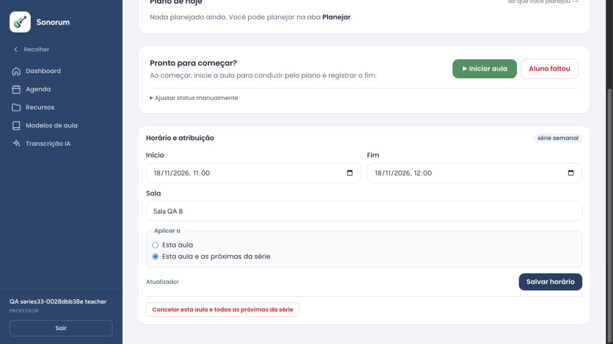
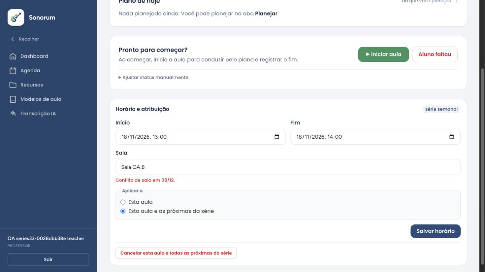
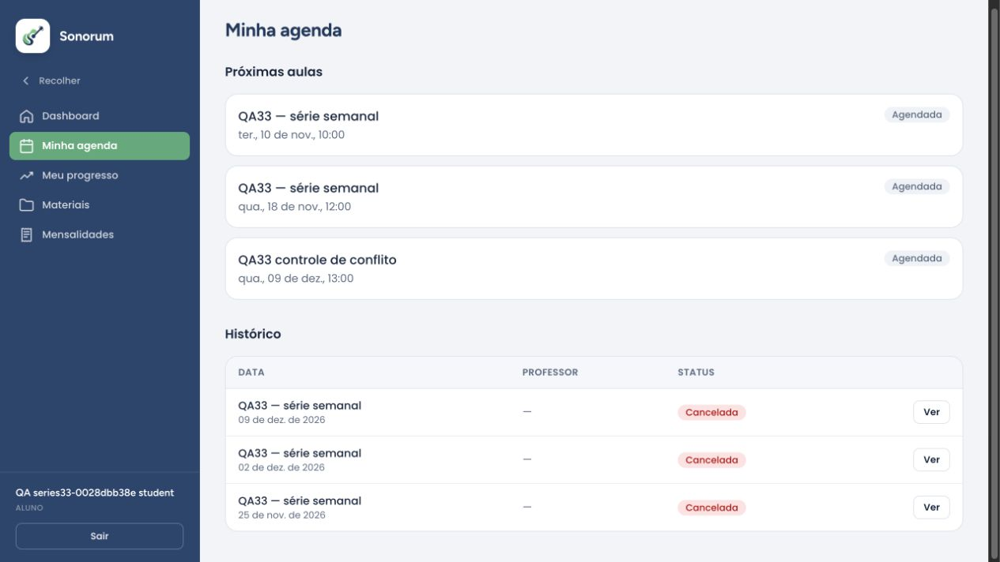

# Agenda: próximas ocorrências, conflito e cancelamento — #33 / #50

Rodada de 07/11/2026 no app publicado em https://app.sonorum.com.br, com reteste da correção no build local de produção. Supabase Sonorum identificado: `lfmxeklzjwhlyraxicgq`. Uso exclusivo de dados fictícios: professor, aluno, escola professional, duas salas, cinco aulas da série e uma aula de controle. Sem telefones, conexões Google ou notificações por e-mail habilitadas nas contas.

## Testes executados

1. Série criada pela UI com preset semanal de um mês: cinco ocorrências em 10/11,17/11,24/11,01/12,08/12 às 10–11h BRT na Sala A; mesma série, intervalos de sete dias, horários13–14h UTC. Quantidade atual do preset registrada como comportamento observado, não como decisão comercial/pedagógica.
2. Na segunda ocorrência, UI alterou para18/11 às11–12h, Sala B e “Esta aula e as próximas da série”. Banco confirmou primeira intacta e quatro seguintes deslocadas em25h, mantendo duração de uma hora e mesma série.
3. Falha #50: após sucesso, select voltou à Sala A e escopo voltou a “Esta aula”. Novo envio sem editar devolveu a sala da segunda ocorrência à A no banco, enquanto as demais permaneceram B. Reprodução exclusivamente com fixture.
4. Correção: `LessonScheduleForm` impede o reset nativo automático após a Server Action, mantendo as seleções do usuário enquanto os novos dados são revalidados. Lint do componente, build/TypeScript e diff-check passaram. Reteste local de troca A→B/escopo futuras e reenvio sem mudanças manteve os dados.
5. Produção corrigida: troca de sala e reenvio sem alterações preservaram Sala B e escopo futuras. Criada aula de controle fora da série, na Sala B em09/12 às13–14h. Tentativa de mover as futuras para13–14h encontrou conflito somente na última ocorrência: UI mostrou “Conflito de sala em09/12.”; comparação integral das seis linhas confirmou nenhuma alteração. Campos, sala e escopo continuaram preenchidos. Mesmo conflito foi verificado no build local.
6. Corrigido para12–13h, sem redigitar sala/escopo: quatro ocorrências atualizadas; primeira e controle intactos. Segundo envio sem editar preservou integralmente as seis linhas (comparação de snapshots).
7. Cancelamento pela UI a partir da terceira ocorrência (25/11): três aulas canceladas (25/11,02/12,09/12), duas primeiras preservadas, controle independente preservado. Banco manteve seis linhas, sem exclusão.
8. Login do aluno pela UI: próxima aula no dashboard permaneceu10/11 às10h; agenda exibiu10/11 às10h e18/11 às12h, mais o controle09/12 às13h. As três canceladas apareceram no histórico com estado Cancelada e não em Próximas aulas. Consulta com sessão do aluno/RLS confirmou três scheduled e três canceled.

## Publicação

Deploy READY `dpl_2nJ4S17wA5DcaBq7SriJnwUSMVWu`, `sonorum-kfozaaq6y-pump-sites.vercel.app`, alias `app.sonorum.com.br`. Nenhuma migração SQL necessária. Durante a atualização do deploy houve uma recarga do painel; os testes de preservação foram repetidos após a página estabilizar na nova versão.

## Limites e observações

- #50 concluído no escopo reproduzido de sala, horário e escopo de aplicação. Troca de professor não exercitada nesta rodada.
- Não foram provocadas falhas de banco no meio da gravação nem disputas concorrentes; o resultado de conflito prévio não prova atomicidade global das atualizações da série.
- Google Agenda, entrega de notificações e outras integrações não foram validados. Escolas fictícias sem essas conexões.
- Na preparação, uma tentativa de login interrompida pela navegação e uma resposta inesperada deixaram uma página de erro. Reload abriu a sessão correta; HTTP autenticado retornou200. Logs de runtime mostraram refresh token ausente da conta QA antiga; a consulta de requests não retornou4xx/5xx naquele intervalo. Causa exata da resposta inesperada não confirmada. Demais logins/logout do teste passaram; não foi atribuída uma nova falha de autenticação sem reprodução.
- #33 e #35 seguem em andamento: recorte técnico de recorrência/cancelamento aprovado, demais cenários e uso real em aula por Matheus continuam pendentes. Não é aprovação de prontidão do piloto.

## Limpeza e evidências

Duas contas Auth, uma escola, duas salas e seis aulas fictícias removidas ao final, com verificações de ausência. Credencial temporária retirada do arquivo auxiliar, servidor local encerrado e abas de teste fechadas. Nenhuma conta real utilizada ou alterada.

Estados por etapa, sem credenciais: [snapshots](evidencias/2026-11-07-serie-estados.json).

