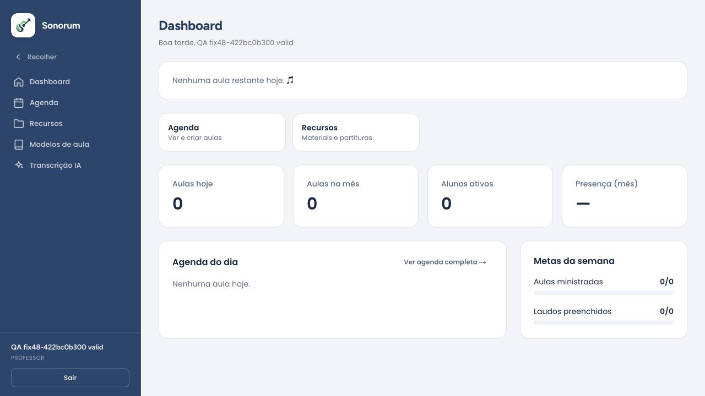
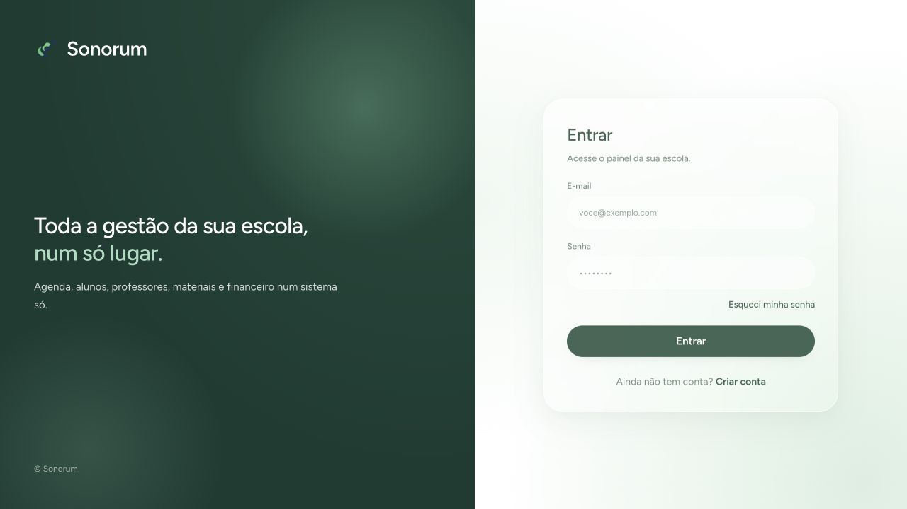

# Sessão de conta removida — #48

Validado em 07/11/2026 no build local e em https://app.sonorum.com.br.

## Causa e correção

O proxy usava os claims de um JWT ainda válido para encaminhar ao painel, enquanto o layout consultava a conta real e voltava ao login. Os redirecionamentos também descartavam os cookies de renovação/remoção produzidos pelo adaptador Supabase. Páginas podiam executar simultaneamente ao layout e acessar `user!.id` com usuário nulo.

O proxy agora confirma a existência da conta e do perfil e compara papel/escola com os claims. Sessões inválidas são encerradas apenas no dispositivo atual. Cookies e cabeçalhos de cache acompanham os redirecionamentos. Falhas temporárias de verificação retornam 503 nas rotas do app e de login/cadastro, sem encerrar deliberadamente a sessão. As páginas que desreferenciavam usuário nulo passam por `requireCurrentUser` antes de consultar seus dados.

## Verificação executada

- TypeScript, ESLint dos arquivos alterados e build de produção passaram; `git diff --check` sem erros.
- 7 testes novos executam proxy, adaptador e guarda reais com dependências isoladas: conta removida; perfil ausente; papel/escola alterados; erros temporários; cookies de refresh e remoção em redirecionamentos; sessão anônima/expirada; guarda contra usuário nulo; superadmin sem escola.
- 17 regressões existentes passaram, incluindo isolamento do professor, notas privadas e planejamento atômico com PostgreSQL temporário.
- HTTP real com Supabase identificado como `lfmxeklzjwhlyraxicgq`, no build local e no domínio publicado: login válido; painel; bloqueio da área administrativa para professor; conta removida com JWT ainda válido; login HTTP 200; painel redireciona uma vez ao login; cookies apagados; novo login no mesmo jar sem limpeza manual; renovação de sessão; perfil removido sem loop no cadastro.
- Navegador: sessão antiga em localhost abriu login; novo login por formulário alcançou painel; remoção da conta logada seguida de recarga voltou ao login. Repetidos login por formulário e recarga após remoção em produção, sem erros de redirecionamento.

Deploy READY: `dpl_Gy3oyPmnpNRBxoJF82yS7vJidgME`, `sonorum-70vf4ioqw-pump-sites.vercel.app`. Alias aplicado apenas a `app.sonorum.com.br`.

## Dados de teste e limites

Foram usadas duas rodadas de três contas fictícias e uma escola por rodada, com e-mails `@sonorum.test`. As seis contas Auth e as duas escolas foram removidas e a ausência foi verificada por ID. Nenhuma conta real foi removida. Credenciais temporárias foram retiradas do arquivo auxiliar. Nenhuma migração SQL foi necessária.

Falhas temporárias e expiração foram cobertas por testes isolados; não foi provocada indisponibilidade no Supabase de produção. Não houve espera pela expiração natural de um JWT. A renovação de sessão foi executada de verdade. A jornada #30 continua em andamento para os demais testes de autenticação, incluindo recuperação/entrega de e-mail.

## Evidências

Próximo defeito registrado: #49 — sidebar no mobile comprime o conteúdo. Ainda não alterado nesta rodada.
